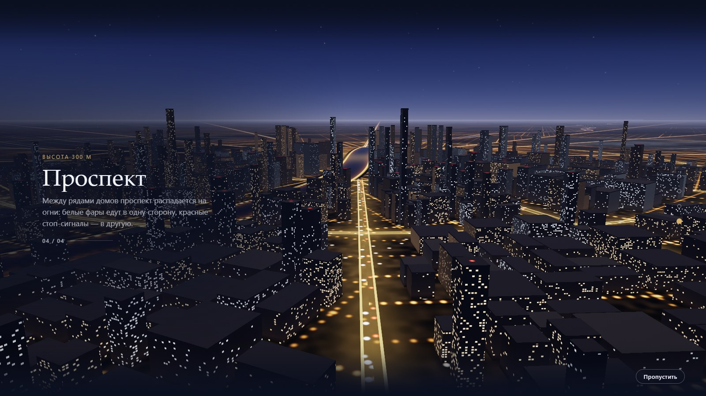
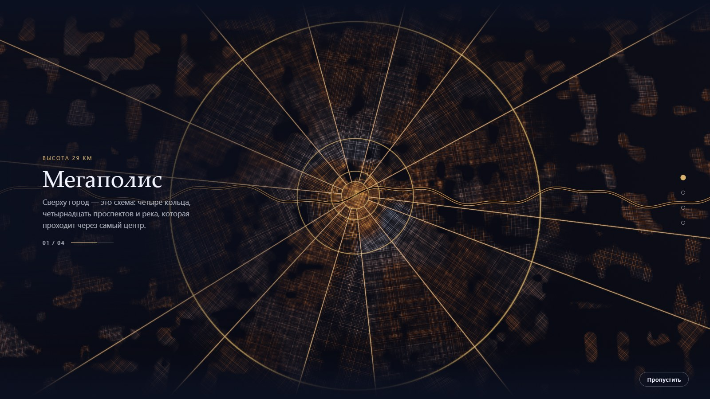
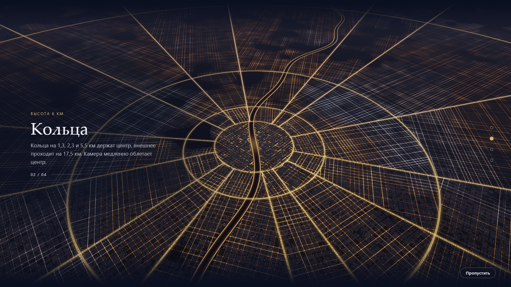
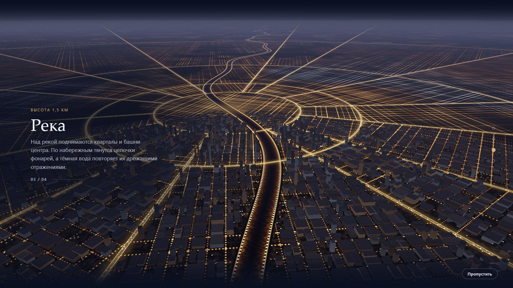

# Город ночью

Процедурный ночной мегаполис в WebGL2: камера пролетает над городом по мере прокрутки страницы — от высоты 29 км до крыш над проспектом.

Ни одного файла текстур, модели или библиотеки. Кольца, проспекты, река, кварталы, дома, окна, фонари и машины считаются в одном фрагментном шейдере для каждого пикселя.



| Мегаполис, 29 км | Кольца, 6 км | Река, 1,5 км |
|---|---|---|
|  |  |  |

## Запуск

Сборка не нужна — достаточно любого статического сервера:

```bash
python -m http.server 5174
# открыть http://localhost:5174
```

## Как это устроено

### Город
- **План.** Четыре кольца, 14 радиальных проспектов, река-синусоида с набережными. Внутри секторов — сетки улиц, повёрнутые по направлению сектора. Плотность застройки убывает от центра и модулируется шумом, парки — провалы шума.
- **Дома.** Луч обходит кварталы сетки (DDA в локальных осях сектора) и пересекается с боксами зданий: 0–4 дома на квартал, высота от ~12 м на окраинах до 200+ м в центре, редкие высотки до 360 м. Квартал пропускается без проверок, если луч проходит выше максимальной высоты для этого радиуса. Выше 8 км дома не считаются вовсе.
- **Огни.** Натриевые и LED-фонари, окна по этажам, машины: белые фары в одну сторону, красные стоп-сигналы в другую. Красные огни на крышах высоток.

### Качество картинки
- **Без муара и мерцания.** Для каждого пикселя считаются ray differentials — размер пикселя на поверхности. Улицы, разметка и окна фильтруются аналитически (интеграл периодической функции по окну пикселя); когда деталь меньше пикселя, она плавно заменяется средним значением.
- **Цвет.** Расчёт в линейном пространстве, OKLab-ограничение насыщенности, ACES-тонмаппинг, sRGB, дизеринг против полос на тёмном небе. Края холста плавно переходят в цвет фона страницы.

### Камера
- Ключевые кадры на каждый шаг, монотонный кубический сплайн (Фриче — Карлсон), высота интерполируется в asinh-пространстве — спуск с 29 км до 300 м ощущается равномерным.
- Критически демпфированная пружина сглаживает прокрутку, лёгкое «дыхание» в простое, параллакс от курсора, вспышка в точке клика.

### Производительность
- **Разрешение по устройству.** Телефон: DPR рендера ≤ 1.25 и бюджет ≈0.45 Мп; встроенная графика: DPR ≤ 1.5, ≈1.6 Мп, старт с масштаба 0.8; остальные: DPR ≤ 2, ≈2.5 Мп. Холст растягивается браузером со сглаживанием, подписи остаются HTML в полном разрешении.
- **Адаптивное качество.** Медиана 10 последних кадров > 28 мс — масштаб сразу ×0.8; медиана 40 кадров > 20 мс — ×0.85; возврат вверх без «пульсации». Интервалы > 150 мс (троттлинг вкладки, фризы) не учитываются. Минимум масштаба 0.5. С масштабом меняются детали: шаги обхода кварталов, радиус домов, звёзды и искры.
- **Частота в простое.** Когда камера стоит, на телефоне и встроенной графике сцена рисуется 30 раз в секунду; на минимальном уровне качества и при `prefers-reduced-motion` «дыхание» камеры выключено и кадры рисуются только при изменениях.
- **Дешёвый шейдер.** Хеши и шум — выборки из текстуры 512×512 вместо целочисленной арифметики; плотность, парки и расстояние до дорог запекаются при старте в карту города 1024×1024, и обход кварталов читает её одной выборкой; принадлежность квартала сектору проверяется скалярными произведениями без `atan`; небо, вода и машины считаются только там, где они видны.
- **Запасные режимы.** Если даже на минимальном масштабе кадр дольше 40 мс несколько секунд — облегчённый шейдер (плоский город без домов и машин); если и он не успевает или WebGL2 нет — кадры пролёта из `docs/frames/` с кроссфейдом по шагам.
- Рендер по требованию, пауза вне экрана и на скрытой вкладке, асинхронная сборка шейдера (`KHR_parallel_shader_compile`), обработка потери WebGL-контекста.
- **Замеры** (RTX 4060, время GPU по `EXT_disjoint_timer_query_webgl2`): десктоп 1585×900 — 0.28 / 0.77 / 1.29 / 1.98 мс по шагам; телефон 390×844 при DPR 3 (буфер 456×987) — 0.09 / 0.10 / 0.33 / 0.46 мс.
- **Отладка:** `?debug` — оверлей с FPS, временем кадра и GPU, масштабом и размером буфера; `?debug&lite` — облегчённый шейдер, `?debug&static` — статичный вид, `?debug&profile=weak` — профиль встроенной графики.

## Структура

```
index.html          страница: первый экран, закреплённая сцена на 4 шага, финал
style.css           вёрстка, подписи шагов, мобильная раскладка, запасной вид
js/gl-scene.js      каркас WebGL2: контекст, шейдеры, размер холста, цикл, адаптивное качество
js/city-shader.js   шейдер города: план, дома, огни, небо, цвет
js/camera.js        ключевые кадры, сплайн, пружина, параллакс
js/noise-tex.js     текстура хешей для шейдера
js/main.js          шаги прокрутки, подписи, навигация, взаимодействие, текстуры, уровни деталей
js/debug.js         оверлей отладки (?debug)
docs/               скриншоты; docs/frames/ — кадры для запасного вида
```

## Совместимость

Нужен браузер с WebGL2 (Chrome, Edge, Firefox, Safari 15+). Учитывается `prefers-reduced-motion`.

## Лицензия

MIT
